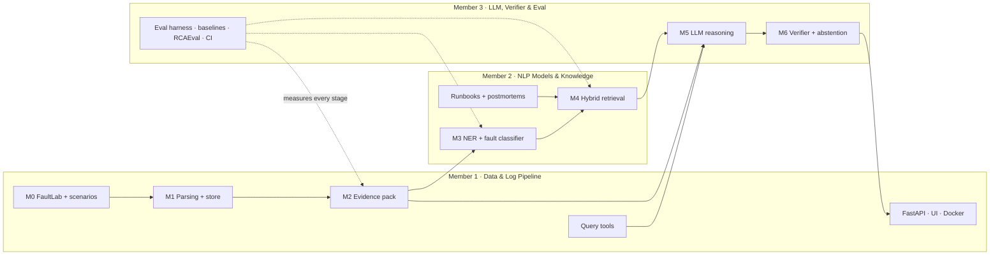

# Incident-Triage Copilot — Work Distribution

| | |
|---|---|
| **Status** | Draft v0.1 — confirm at the Week 1 kickoff |
| **Date** | 2026-11-25 |
| **Builds on** | [01-master-architecture.md](01-master-architecture.md). Module IDs (M0–M6), schemas and metrics are defined there. |
| **Plan length** | 10 weeks, 5 gates. The held-out test split is run once, at Gate 5. |

---

## Contents

1. [Team and roles](#1-team-and-roles)
2. [How the split works](#2-how-the-split-works)
3. [Ownership map](#3-ownership-map)
4. [Handoff contracts between members](#4-handoff-contracts-between-members)
5. [Member 1 — Data & Log Pipeline](#5-member-1--data--log-pipeline)
6. [Member 2 — NLP Models & Knowledge](#6-member-2--nlp-models--knowledge)
7. [Member 3 — LLM, Verifier & Evaluation](#7-member-3--llm-verifier--evaluation)
8. [Combined 10-week timeline](#8-combined-10-week-timeline)
9. [Gate checklists](#9-gate-checklists)
10. [Shared work and RACI](#10-shared-work-and-raci)
11. [Anti-leakage protocol](#11-anti-leakage-protocol)
12. [Working agreements](#12-working-agreements)
13. [Report and viva split](#13-report-and-viva-split)
14. [Contingencies, MVP line and drop order](#14-contingencies-mvp-line-and-drop-order)

---

## 1. Team and roles

| Role | Member | Pipeline layer | Modules | Owns metrics |
|---|---|---|---|---|
| **Member 1** | Vaibhav Chaubey | Data & Log Pipeline | M0, M1, M2, query tools, API, UI, Docker | Parsing accuracy · gold-template recall · pack tokens |
| **Member 2** | Sourav Kumar | NLP Models & Knowledge | M3, M4, runbooks, postmortems | NER F1 · fault-type macro-F1 · Recall@k, MRR |
| **Member 3** | Satyajeet Das | LLM, Verifier & Evaluation | M5, M6, orchestrator, eval harness, CI | Top-1/Top-3 · AC@k · faithfulness · abstention |

> Names follow the order on the proposal's title slide. If the team agreed a different mapping, edit this table only; the rest of the doc uses "Member 1/2/3".

---

## 2. How the split works

1. **Split by pipeline layer.** Each member owns a contiguous slice of the pipeline end to end: code, tests, metric and report chapter.
2. **Each member owns a metric.** If a metric is bad, its owner fixes it or explains it in the error analysis.
3. **Contracts first.** In Week 1 all three members co-write `triage/schemas.py`, the fault taxonomy and the citation-ID scheme. These are frozen at the end of Week 1.
4. **Stubs before real code.** By the end of Week 1, every stage (`build_pack`, `analyze`, `retrieve`, `rank_causes`, `verify`) has a stub that returns valid objects. The pipeline runs end to end from day 5 and gets better stage by stage. Nobody waits on anybody.
5. **Integrate at every gate.** Each gate ends with a merged `main`, a green CI run, and the next row of the improvement table.

---

## 3. Ownership map

| Area | Directory | Owner | Reviewer / backup |
|---|---|---|---|
| FaultLab app, injectors, load gen | `apps/faultlab/` | Member 1 | Member 3 |
| Scenario specs, gold templates, splits | `data/scenarios/`, `data/splits/` | Member 1 | Member 3 |
| M1 Parsing & ingestion | `triage/ingest/` | Member 1 | Member 3 |
| M2 Log reduction & evidence pack | `triage/reduce/` | Member 1 | Member 3 |
| Read-only query tools | `triage/reason/tools.py` | Member 1 | Member 3 |
| API, UI, Docker, Makefile | `triage/api/`, `ui/`, `docker-compose.yml`, `Makefile` | Member 1 | Member 3 |
| Runbooks & postmortems (content) | `kb/` | Member 2 | Member 3 (format/quality only, see [§11](#11-anti-leakage-protocol)) |
| M3 NER & fault classifier | `triage/nlp/`, `data/labels/ner/` | Member 2 | Member 1 |
| M4 Knowledge retrieval | `triage/kb/` | Member 2 | Member 1 |
| M5 LLM reasoning, prompts, ledger | `triage/reason/` (except `tools.py`) | Member 3 | Member 2 |
| M6 Verifier & abstention | `triage/verify/` | Member 3 | Member 2 |
| Orchestrator, config | `triage/pipeline.py`, `triage/config.py`, `configs/` | Member 3 | Member 2 |
| Eval harness, baselines, RCAEval, Loghub loaders | `triage/eval/` | Member 3 | Member 2 |
| CI | `.github/workflows/` | Member 3 | Member 2 |
| Shared contracts | `triage/schemas.py` | **All three** (any change needs 3 approvals) | — |

This table becomes `.github/CODEOWNERS` in Week 1. Reviews run in a cycle: Member 3 reviews Member 1's work, Member 2 reviews Member 3's, and Member 1 reviews Member 2's. The one exception is `kb/` content, which Member 3 reviews ([§11](#11-anti-leakage-protocol)). Every module has a second person who can run and fix it.

---

## 4. Handoff contracts between members

Each handoff is a working function or artifact that matches `schemas.py`. A stub is due in Week 1 and the real version on the week shown.

| # | From → To | What | Interface | Stub | Real |
|---|---|---|---|---|---|
| H1 | All → all | Schemas, fault taxonomy, citation IDs | `triage/schemas.py` | W1 (day 3) | W1 (frozen) |
| H2 | Member 1 → Member 3 (Member 2 only after `kb-v1`) | 2 small **fixture scenarios**, ingested, with gold | `tests/fixtures/` + Postgres dump | — | W1 |
| H3 | Member 1 → Member 3 | 15 ingested FaultLab scenarios | Postgres + `scenario.yaml` | — | W2 |
| H4 | Member 2 → Member 3 | Runbook corpus v1 + BM25 retrieval | `retrieve(query) -> list[KBChunk]` | W1 | W2 |
| H5 | Member 1 → Member 2 | Soak-run **train** windows (labelled lines + templates; packs once H6 lands) | `data/train/` | — | W3 |
| H6 | Member 1 → Members 2, 3 | Real evidence pack builder | `build_pack(alert) -> EvidencePack` | W1 | W4 |
| H7 | Member 2 → Member 3 | NER + TF-IDF fault classifier + query builder | `analyze(pack)`, `build_query(...)` | W1 | W4 |
| H8 | Member 3 → Member 2 | Gold runbook-step labels per scenario (for Recall@k) | `scenario.yaml: gold.runbook_steps` | — | W5 |
| H9 | Member 1 → Member 3 | Read-only query tools | `filter_logs`, `count_by_template`, `context_around` | W1 | W6 |
| H10 | Member 1 → all | Frozen 30–50 scenarios + split manifest hash | `data/splits/manifest.json` | — | W6 |
| H11 | Member 2 → Member 3 | Hybrid retrieval + rerank + BERT classifier | same interfaces as H4/H7 | — | W6 |
| H12 | Member 3 → Member 1 | Ingest adapter for RCAEval (uses Member 1's adapter API) | `triage/eval/loaders/rcaeval.py` | — | W5 |
| H13 | Member 3 → Member 1 | Real `TriageResult` from full pipeline for UI | `POST /v1/triage` | W1 | W8 |
| H14 | Member 3 → all | Eval harness reporting every stage's metric | `triage eval` → `runs/*/summary.csv` | — | W2, then grows |

---

## 5. Member 1 — Data & Log Pipeline

**Mission:** turn raw logs into a small, correct evidence pack, and own the data and serving stack the others build on.

**Owns:** M0 FaultLab and scenarios · M1 parsing & ingestion · M2 reduction & evidence pack · read-only query tools · FastAPI · Streamlit UI · Docker Compose · `make demo`.

**Metrics owned:**
- Grouping / parsing accuracy (GA, PA, FGA, FTA) on Loghub-2.0, and GA on FaultLab.
- Gold-template recall in pack.
- Pack tokens and compression ratio.

### Week-by-week

**Weeks 1–2 · Requirements & data → Gate 1**
- [ ] Repo skeleton: `pyproject.toml`, ruff, pytest, `Makefile`, `docker-compose.yml` with Postgres 16, `CODEOWNERS`
- [ ] Postgres schema + migrations ([architecture §7.1](01-master-architecture.md#71-postgresql-schema)), with `triage_rw`, `triage_ro` and `triage_eval` roles
- [ ] Co-author `schemas.py` and the fault taxonomy (H1)
- [ ] FaultLab v0: 6 services with **deliberately different log formats**, Postgres, Redis, toxiproxy, Locust
- [ ] **2 fixture scenarios** committed for Member 3 by end of Week 1 (H2); Member 2 uses them only after `kb-v1`
- [ ] Injectors for at least 5 fault types; scenario runner with **paired control runs**
- [ ] 15 scenarios generated; `triage split assign` puts each into dev or test as it is created
- [ ] Format adapters + masking + Drain3 + bulk `COPY` ingest + `template_counts` rollups
- [ ] Drain3 on Loghub-2.0, with GA / PA / FGA / FTA from `triage eval parser`

**Weeks 3–4 · Core: logs & NLP → Gate 2**
- [ ] Dependency graph file; window and service filter
- [ ] Scoring features: novelty, log-ratio, IDF, level, proximity, early onset
- [ ] **Soak-run generator** → labelled train windows for Member 2 (H5, due early Week 3)
- [ ] Gold-template labeller from paired runs (`triage gold label`) plus manual review
- [ ] Budget-capped pack builder with symptom anchor and per-service cap (H6)
- [ ] Metric z-score summariser (`M:` items)
- [ ] 30 scenarios: a distractor in every one, plus **no-fault** and **unlogged-fault** scenarios for abstention
- [ ] Tune score weights on dev; report gold-template recall vs token budget

**Weeks 5–6 · Core: retrieval → Gate 3**
- [ ] Read-only query tools with row/time caps and tests showing that writes fail (H9)
- [ ] LLM-parser comparison on a Loghub-2.0 subset (cached); keep or drop it based on the numbers
- [ ] Support Member 3's RCAEval loader through the ingest adapter API (H12)
- [ ] Freeze the 30–50 scenario set; `triage split freeze` → manifest + hash (H10)
- [ ] FastAPI skeleton serving all endpoints (stubbed where needed)

**Weeks 7–8 · Integration → Gate 4**
- [ ] FastAPI endpoints complete ([architecture §5](01-master-architecture.md#orchestrator-api-and-ui))
- [ ] Streamlit UI:
  - cause cards with a confidence bar
  - clickable citations (line ± context, template sparkline, runbook step)
  - verified/rejected badges
  - Approve/Reject fix
  - abstention view
- [ ] Dockerfiles; `make demo` works from a clean clone (tested by Member 2)
- [ ] Ingestion performance pass on RCAEval-scale data (streaming chunks, persisted Drain3 state)

**Weeks 9–10 · Testing & evaluation → Gate 5**
- [ ] Error analysis for every test miss attributed to stages M1/M2
- [ ] Pick demo scenarios (one clean win, one "loudest signal is downstream", one abstention); write the demo script
- [ ] Report chapters 1, 3, 4 ([§13](#13-report-and-viva-split))

**Definition of done for Member 1:** `triage ingest` + `triage gold label` + `build_pack` run on every scenario; gold-template recall is reported with a CI; `make demo` works on a clean machine.

---

## 6. Member 2 — NLP Models & Knowledge

**Mission:** turn the evidence pack into structured signals (entities and fault type) and find the right runbook steps by meaning.

**Owns:** runbooks and postmortems (`kb/`) · M3 NER and fault classifiers · M4 hybrid retrieval and reranker · NER labelled data · model checkpoints.

**Metrics owned:**
- NER entity-level F1 (weak-label vs fine-tuned).
- Fault-type macro-F1 (TF-IDF+LR vs BERT).
- Recall@1/3/5 and MRR (BM25 / dense / hybrid / + rerank).

### Week-by-week

**Weeks 1–2 · Requirements & data → Gate 1**
- [ ] Co-author `schemas.py`; **lead** the fault taxonomy with descriptions (H1)
- [ ] Runbook template (front matter + numbered steps)
- [ ] **Write runbook corpus v1 blind** (see [§11](#11-anti-leakage-protocol)):
  - at least 1 runbook per fault type
  - about 15 runbooks
  - 4–8 steps each, generic service names only
- [ ] KB loader + step-level chunker (`R:<doc>#<step>`); BM25 `retrieve()` (H4)
- [ ] Tag `kb-v1` at Gate 1; only after the tag may Member 2 look at scenario data
- [ ] NER label guidelines (6 entity types) and weak-labelling rules (regex + exception/error-code gazetteers), drafted on Loghub-2.0 lines; FaultLab service names join the gazetteer only after `kb-v1`

**Weeks 3–4 · Core: logs & NLP → Gate 2**
- [ ] Weak-label soak train lines (H5) and Loghub-2.0 lines
- [ ] Hand-label the **NER test set** (300–500 lines from dev scenarios, never test); Member 1 double-labels 100 of them for κ
- [ ] Fine-tune the NER token classifier (`distilbert-base-cased`); compare with the weak-label baseline
- [ ] TF-IDF (word + char n-grams) + logistic regression fault classifier: v0 on soak train windows (template text per window) in Week 3, retrained on real train packs once H6 lands in Week 4
- [ ] `analyze(pack)` and `build_query(pack, signals)` integrated in the pipeline (H7)

**Weeks 5–6 · Core: retrieval → Gate 3**
- [ ] Sentence embeddings + FAISS; RRF fusion; cross-encoder reranker
- [ ] Fine-tune the BERT fault classifier and compare with TF-IDF (macro-F1 + confusion matrix)
- [ ] **Paraphrased distractor runbooks** for the wrong fault types
- [ ] Public postmortems, with source URL + license recorded in front matter
- [ ] **Retrieval ablation table** using Member 3's gold step labels (H8): BM25 / dense / hybrid / + rerank / + fault-type boost, with Recall@k and MRR (H11)

**Weeks 7–8 · Integration → Gate 4**
- [ ] Load models once per process; check CPU inference latency fits the budget
- [ ] Model cards (data, metrics, limits) for NER and the classifier
- [ ] Build NLI evaluation pairs (runbook step ↔ fix text) for Member 3's verifier threshold
- [ ] Domain-shift check: classifier and NER on RCAEval packs
- [ ] Publish checkpoints as release assets
- [ ] Run `make demo` from a clean clone (verifies Member 1's deliverable)

**Weeks 9–10 · Testing & evaluation → Gate 5**
- [ ] Error analysis for every test miss attributed to stages M3/M4
- [ ] Faithfulness annotation share ([§10](#10-shared-work-and-raci))
- [ ] **Report editor**; report chapters 2, 5, 9

**Definition of done for Member 2:** `analyze` and `retrieve` run on every scenario; NER F1, macro-F1, Recall@k and MRR are reported on held-out data; the retrieval ablation table is complete.

---

## 7. Member 3 — LLM, Verifier & Evaluation

**Mission:** turn evidence into ranked, cited, verified causes, and prove how well the whole system works with honest numbers.

**Owns:** M5 LLM reasoning (prompts, LLM client, cache, evidence ledger, summary) · M6 verifier and abstention · pipeline orchestrator and configs · evaluation harness, baselines, RCAEval loader, vector-blob experiment · CI.

**Metrics owned:**
- Top-1 / Top-3 and AC@k / Avg@k.
- Faithfulness and verifier precision/recall.
- Correct abstentions and confident errors.
- Cost: tokens and latency.

### Week-by-week

**Weeks 1–2 · Requirements & data → Gate 1**
- [ ] Co-author `schemas.py` (H1); **stubs for every stage** and the pipeline orchestrator, so `triage run` works end to end on fixture scenarios by day 5
- [ ] `LLMClient` with hosted API and local backends, plus an on-disk response cache
- [ ] `@traced` stage decorator → `trace.jsonl`; config hashing
- [ ] CI: ruff + pytest + schema contract tests + smoke eval with cached LLM responses
- [ ] Eval harness: `triage eval`, `summary.csv`, Top-k, AC@k (H14)
- [ ] **B0 grep + BM25** baseline on the dev scenarios; **B1 raw-log LLM** baseline

**Weeks 3–4 · Core: logs & NLP → Gate 2**
- [ ] Cause-ranking prompt v0 with citation-ID rules; Pydantic validation + one repair retry
- [ ] Gold-template recall and pack-token metrics in the harness
- [ ] **B2 vector-blob** baseline
- [ ] **Vector-blob experiment**: raw-line embedding vs template embedding vs M2 scoring at a fixed token budget
- [ ] **Label gold runbook steps** for every scenario, after `kb-v1` is tagged (H8; Member 3 is neither the runbook author nor the scenario author)
- [ ] S1 row of the improvement table on dev

**Weeks 5–6 · Core: retrieval → Gate 3**
- [ ] RCAEval RE2/RE3 loader + fault-label mapping; ingest at least 1 system through Member 1's adapter (H12)
- [ ] Evidence ledger; verifier **stage 1** (existence)
- [ ] LLM ranking v1 using pack + signals + retrieved steps
- [ ] Baselines on the RCAEval dev subset; S2 and S3 rows on dev

**Weeks 7–8 · Integration → Gate 4**
- [ ] Tool-calling loop with `max_tool_calls`; tool results added to the ledger (S4 row)
- [ ] Verifier **stage 2**: exact / count / time / quote / entity checks, and NLI on runbook text (threshold from Member 2's NLI pairs)
- [ ] Verifier **stage 3**: calibrated confidence (logistic regression on dev), abstention threshold, risk–coverage curve
- [ ] Incident summary generated only from verified claims
- [ ] Full **S5** on all dev scenarios + RCAEval dev subset; automatic **stage-attribution** table for misses
- [ ] Real `TriageResult` served to the UI (H13)

**Weeks 9–10 · Testing & evaluation → Gate 5**
- [ ] The **single held-out test run** (`triage eval --split test --final`, all configs), with all three members present; outputs committed immediately
- [ ] Improvement table with 95% bootstrap CIs and paired comparisons
- [ ] Coordinate the faithfulness annotation (2 annotators per claim, blind to verifier verdicts, κ reported)
- [ ] Report chapters 6 and 7

**Definition of done for Member 3:** every row of the improvement table can be reproduced with one command; the test split was run exactly once; faithfulness and abstention numbers are backed by human labels.

---

## 8. Combined 10-week timeline

```mermaid
gantt
    title Incident-Triage Copilot — 10-week plan
    dateFormat  X
    axisFormat  W%s
    tickInterval 1second
    section Member 1
    Skeleton, DB, FaultLab, 15 scenarios, Drain3   :m1a, 0, 2s
    Scoring, pack builder, soak runs, 30 scenarios :m1b, after m1a, 2s
    Query tools, scenario freeze, API skeleton     :m1c, after m1b, 2s
    API, UI, Docker, make demo                     :m1d, after m1c, 2s
    Error analysis, demo, report                   :m1e, after m1d, 2s
    section Member 2
    Taxonomy, runbooks v1 (blind), BM25            :m2a, 0, 2s
    NER weak to fine-tuned, TF-IDF classifier      :m2b, after m2a, 2s
    Dense, RRF, rerank, BERT clf, ablation         :m2c, after m2b, 2s
    Integration, model cards, NLI pairs            :m2d, after m2c, 2s
    Error analysis, annotation, report editor      :m2e, after m2d, 2s
    section Member 3
    Stubs, LLM client, CI, harness, B0, B1         :m3a, 0, 2s
    Prompt v0, B2, vector-blob, gold steps         :m3b, after m3a, 2s
    RCAEval loader, ledger, verifier stage 1       :m3c, after m3b, 2s
    Tools, verifier 2-3, abstention, full S5       :m3d, after m3c, 2s
    Held-out test run, CIs, report                 :m3e, after m3d, 2s
    section Gates
    Gate 1 baseline end to end     :milestone, g1, after m1a, 0s
    Gate 2 gold templates in pack  :milestone, g2, after m1b, 0s
    Gate 3 retrieval ablation      :milestone, g3, after m1c, 0s
    Gate 4 full pipeline           :milestone, g4, after m1d, 0s
    Gate 5 report + demo frozen    :milestone, g5, after m1e, 0s
```

| Week | Member 1 | Member 2 | Member 3 | Shared |
|---|---|---|---|---|
| 1 | Repo, DB, FaultLab v0, fixtures | Taxonomy, runbook template, runbooks | Stubs, orchestrator, LLM client, CI | **Contract freeze** (schemas, taxonomy, IDs); rubric mapping |
| 2 | Injectors, 15 scenarios, Drain3 + ingest, Loghub eval | Runbooks v1 → `kb-v1`, BM25, NER guidelines | Harness, B0, B1 | **Gate 1** |
| 3 | Scoring, soak runs, gold labeller | Weak labels, NER test set, TF-IDF classifier | Prompt v0, B2 | NER double-labelling (Member 1) |
| 4 | Pack builder, 30 scenarios + distractors + abstention | NER fine-tune, `analyze`, `build_query` | Vector-blob experiment, gold steps, S1 | **Gate 2** |
| 5 | Query tools, LLM parser comparison | Dense + RRF + rerank, BERT classifier | RCAEval loader, ledger, verifier stage 1 | — |
| 6 | Scenario freeze + split hash, API skeleton | Distractor runbooks, postmortems, retrieval ablation | LLM ranking v1, S2/S3, RCAEval baselines | **Gate 3** |
| 7 | API complete, UI | Model integration, model cards, NLI pairs | Tool loop, verifier stage 2 | — |
| 8 | Docker, `make demo`, ingest perf | Domain-shift check, clean-clone test | Verifier stage 3, abstention, full S5 | **Gate 4** — feature freeze |
| 9 | Error analysis (stages M1/M2) | Error analysis (stages M3/M4), annotation | **Test run once**, CIs, annotation lead | Faithfulness annotation |
| 10 | Demo script, report ch. 1/3/4 | Report editing, ch. 2/5/9 | Report ch. 6/7 | **Gate 5** — report, demo, viva prep |

**Load note:** Member 1 is heaviest in Weeks 1–4 (app + data + parsing), Member 3 in Weeks 7–9 (verifier + final evaluation), and Member 2 is steadiest. The contingencies in [§14](#14-contingencies-mvp-line-and-drop-order) move work toward whoever has slack.

---

## 9. Gate checklists

Each gate is a short meeting where the owner of each item **demonstrates** it by running a command, not by describing it. Results go into `runs/` and the gate is recorded in `docs/gates.md`.

### Gate 1 — Baseline runs end to end (end of Week 2)
- [ ] `schemas.py` frozen; contract tests green in CI *(all)*
- [ ] 15 FaultLab scenarios generated and ingested *(Member 1)*
- [ ] Drain3 GA/PA/FGA/FTA on Loghub-2.0 reported *(Member 1)*
- [ ] `kb-v1` tagged, with at least 1 runbook per fault type *(Member 2)*
- [ ] `triage eval --split dev -c configs/ablations/b0.yaml` produces `summary.csv` *(Member 3)*
- [ ] B1 runs on at least 5 dev scenarios *(Member 3)*
- [ ] Targets ([architecture §13](01-master-architecture.md#13-non-functional-targets)) and open decisions ([§17](01-master-architecture.md#17-open-decisions-and-working-defaults)) taken to the guide *(all)*

### Gate 2 — Gold templates in pack (end of Week 4)
- [ ] `build_pack` real; gold-template recall ≥ 0.9 on dev at the default budget, or a documented gap *(Member 1)*
- [ ] 30 scenarios with distractors, plus no-fault and unlogged scenarios *(Member 1)*
- [ ] NER F1 (weak vs fine-tuned) on the hand-labelled test set; κ reported *(Member 2)*
- [ ] TF-IDF classifier macro-F1 on dev packs *(Member 2)*
- [ ] B2 and vector-blob experiment, first results *(Member 3)*
- [ ] S1 row on dev *(Member 3)*

### Gate 3 — Retrieval ablation done (end of Week 6)
- [ ] Retrieval ablation table (Recall@1/3/5, MRR) *(Member 2)*
- [ ] BERT vs TF-IDF classifier comparison *(Member 2)*
- [ ] 30–50 scenarios frozen; `data/splits/manifest.json` hash committed *(Member 1)*
- [ ] Query tools merged; a test proves writes fail under `triage_ro` *(Member 1)*
- [ ] At least 1 RCAEval system ingested; baselines run on its dev subset *(Member 3)*
- [ ] S2 and S3 rows on dev *(Member 3)*

### Gate 4 — Full pipeline, all scenarios (end of Week 8)
- [ ] S5 (full system) on all dev scenarios + RCAEval dev subset *(Member 3)*
- [ ] Verifier and abstention thresholds tuned on dev only; risk–coverage curve *(Member 3)*
- [ ] `make demo` → UI → triage any dev scenario, tested from a clean clone by Member 2 *(Member 1)*
- [ ] Citations clickable; Approve/Reject logged *(Member 1)*
- [ ] CI green, including the smoke eval *(Member 3)*
- [ ] **Feature freeze**: only bug fixes, analysis and writing after this point *(all)*

### Gate 5 — Report and demo frozen (end of Week 10)
- [ ] One held-out test run, committed with config hashes *(Member 3, all present)*
- [ ] Improvement table with 95% CIs *(Member 3)*
- [ ] Faithfulness annotation complete; κ reported *(all)*
- [ ] Error analysis: every test miss attributed to a stage and explained *(each owner)*
- [ ] Report, slides, demo script/video, viva prep *(all)*

---

## 10. Shared work and RACI

**R** = does the work · **A** = accountable (one per row) · **C** = consulted · **I** = informed

| Item | Member 1 | Member 2 | Member 3 |
|---|---|---|---|
| `schemas.py`, citation IDs | R | R | **A** |
| Fault taxonomy | C | **A** | C |
| Scenario design + ground truth | **A** | I (after `kb-v1`) | C (spot-check) |
| Gold-template labels | **A** | — | C (spot-check 20%) |
| Gold runbook-step labels | I | — (blind) | **A** |
| NER test set | R (double-label 100 lines) | **A** | I |
| NLI threshold pairs | — | **A** | C |
| Split assignment + freeze | **A** | I | C |
| Held-out test run | I (present) | I (present) | **A** |
| Faithfulness annotation | R | R | **A** |
| Docker / `make demo` | **A** | C (clean-clone test) | C |
| CI | C | C | **A** |
| Report (editor) | R | **A** | R |
| Demo script | **A** | C | C |
| Weekly integration merge | R | R | **A** |

**Labelling load:** the faithfulness annotation (about 150–200 sampled claims, 2 annotators each) is split evenly, so each member labels about 100–130 claims. Annotators **do not see the verifier's verdict** while labelling.

---

## 11. Anti-leakage protocol

Runbook leakage is one of the two risks the proposal says could sink the grade. These rules prevent it and make it auditable.

1. **Runbooks are written blind.** Member 2 writes `kb-v1` in Weeks 1–2 from the fault taxonomy and general SRE knowledge only. Until `kb-v1` is tagged, Member 2 does not open `apps/faultlab/`, `data/scenarios/`, `tests/fixtures/`, or FaultLab logs.
2. **Reviews respect blindness.** Member 3, not Member 1 (the scenario author), reviews `kb/` content PRs. Member 2 does not review FaultLab PRs before `kb-v1`.
3. **Runbooks use generic names.** CI greps `kb/runbooks/` for FaultLab service identifiers (e.g. `payment-svc`, `cart-svc`; generic words such as "gateway" are allowed) and scenario IDs, and fails on any match.
4. **After `kb-v1`, runbooks are append-only.** Only distractor runbooks and postmortems may be added. Every edit to an existing runbook is logged in `kb/CHANGELOG.md` with a reason and reviewed by Member 3.
5. **Gold runbook steps are labelled by a third party.** Member 3 labels them, and is neither the runbook author nor the scenario author.
6. **Nobody hand-picks splits.** `triage split assign` puts each new scenario into dev or test with a fixed seed, stratified by fault type, as soon as it is generated. Test scenarios are never evaluated before the final run. `triage split freeze` locks the set, and the manifest hash is committed at Gate 3.
7. **All tuning happens on dev.** Score weights, thresholds, prompt changes and model selection use `dev` only. Classifiers train on `train` (soak runs) only.
8. **The test split is run once.** `--final` plus a manifest-hash check. All three members are present, outputs are committed immediately, and every number is reported, good or bad.
9. **The pipeline cannot see ground truth.** Gold labels live in the `scenario_gold` table, which only the `triage_eval` role (eval harness) can read. A unit test asserts that no pipeline code path reads the `gold` block of `scenario.yaml`.

---

## 12. Working agreements

**Git and reviews**
- `main` is protected: PR required, CI green, 1 approval from the owner's designated reviewer ([§3](#3-ownership-map)).
- Branch names: `<type>/<short-name>`, e.g. `feat/evidence-pack` or `fix/drain3-masking`. The full Git rules and the `/start-task`, `/ship`, `/sync` and `/handoff` team commands are in the root [`CLAUDE.md`](../CLAUDE.md).
- **Contract changes** (anything in `schemas.py` or the taxonomy) use the label `contract-change`, need all 3 approvals, and bump `SCHEMA_VERSION`.

**Cadence**
- **Monday (30 min):** plan the week, flag blockers.
- **Thursday (60 min):** integration. Everyone merges, `triage eval --split dev` runs on the latest `main`, and the improvement table is updated.
- **End of each gate week:** gate review ([§9](#9-gate-checklists)), then a short update to the guide.

**Tracking**
- GitHub Projects board.
- Labels: `M0`–`M6`, `gate-1`…`gate-5`, `blocked`, `contract-change`, `stretch`.
- Every checkbox in [§5](#5-member-1--data--log-pipeline)–[§7](#7-member-3--llm-verifier--evaluation) becomes an issue.

**Definition of done (any task)**
- Code merged with tests.
- Output validates against `schemas.py`.
- The metric is produced by `triage eval`, not by a notebook.
- One paragraph in the module's `README.md` explains what changed and why.

**Results rule:** a number goes into the report only if it was produced by `triage eval`, from a committed config, with its run directory in `runs/`.

---

## 13. Report and viva split

| Chapter | Lead | Content |
|---|---|---|
| 1. Introduction & motivation | Member 1 | Problem, why triage is slow, objectives O1–O4 |
| 2. Related work | Member 2 | Vendor tools, OpenRCA, RCAEval, log parsing, RAG and verification |
| 3. System architecture | Member 1 | From [01-master-architecture.md](01-master-architecture.md) |
| 4. Data | Member 1 | FaultLab, scenarios, ground truth, RCAEval, Loghub-2.0 |
| 5. NLP components | Member 2 | NER, fault classification, hybrid retrieval, ablations |
| 6. LLM reasoning & verification | Member 3 | Prompting, tools, ledger, verifier, abstention |
| 7. Evaluation & results | Member 3 | Improvement table, vector-blob experiment, CIs, cost |
| 8. Error analysis | All | Each owner explains the misses attributed to their stages |
| 9. Limitations, ethics & conclusion | Member 2 | Synthetic vs real, threats to validity, future work |

**Editor:** Member 2 (consistent voice, figures, references).

**Viva:** each member presents their own layer and its metrics (about 4 minutes each), then Member 3 presents the improvement table. **Every member must be able to explain the end-to-end flow and every row of the improvement table**; rehearse with swapped roles in Week 10.

---

## 14. Contingencies, MVP line and drop order

### MVP line (must exist for a complete project)
- FaultLab with at least 30 scenarios and exact ground truth.
- Drain3 parsing, evidence pack, and gold-template recall.
- Weak-label NER, TF-IDF fault classifier, hybrid BM25 + dense retrieval.
- LLM cause ranking with citations.
- Verifier: existence + exact/count checks + abstention.
- B0 and B1 baselines, the improvement table on dev and test, and RCAEval on at least 1 system.

### Drop order (if behind, cut from the top)
1. LLM-parser comparison (M1)
2. Learned ranker for M2 scores; fault-type boost in retrieval
3. `auth_cert_failure` injector
4. Public postmortems in the KB
5. Read-only query tools / S4 row (M5 still works on the pack alone)
6. BERT fault classifier (TF-IDF ships instead)
7. Cross-encoder reranker

**Never cut:** verifier existence and exact checks, abstention, baselines, the single held-out test run, error analysis.

### Who absorbs what

| Situation | Action |
|---|---|
| Member 1 behind at Gate 2 | Streamlit UI moves to Member 3 (it renders `TriageResult`, which Member 3 owns); Member 2 takes the KB endpoints of the API |
| Member 2 behind at Gate 3 | BERT classifier and reranker are cut first (moved to the top of the drop order); Member 3 helps with the retrieval ablation runs |
| Member 3 behind at Gate 4 | S4 (tools) dropped; Member 1 takes the RCAEval ingest runs; Member 2 runs the NLI threshold tuning |
| FaultLab injectors flaky | Cut to the 6 most reliable fault types; lean harder on RCAEval |
| LLM budget exhausted | Switch `reasoner.backend: local`; rely on the response cache for reruns |
| A member unavailable for a week | Their reviewer/backup ([§3](#3-ownership-map)) covers; the stubs keep the pipeline running |
